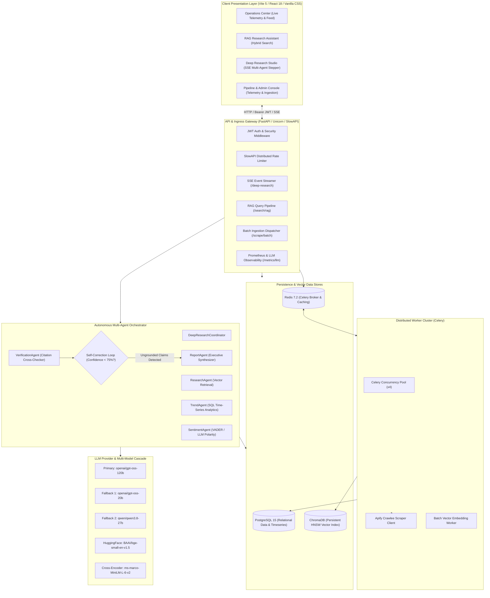
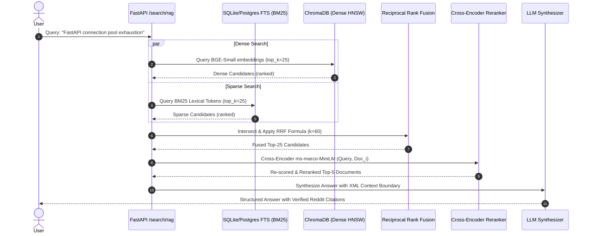
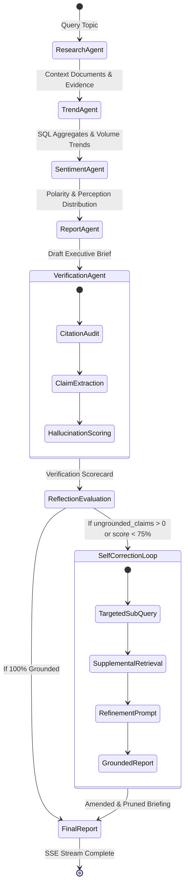
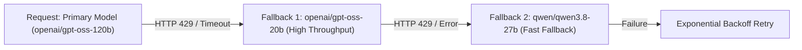

# System Architecture & Technical Specification: Reddit Intelligence Platform

> **Document Classification:** Engineering Whitepaper & Systems Design Specification  
> **Target Audience:** Principal AI Engineers, Systems Architects, and Technical Hiring Committees  
> **System Status:** Production v2.4 (Distributed Async Microservice Architecture)

---

## 1. High-Level Architectural Topology

The Reddit Intelligence Platform is a production-grade, distributed AI engine designed for enterprise market intelligence, automated developer sentiment mining, and evidence-grounded research synthesis.

---

## 2. Hybrid Retrieval Architecture & Reciprocal Rank Fusion (RRF)

### The Domain Challenge
Standard semantic vector embeddings (dense retrieval) struggle with developer and Reddit forum content due to:
1. **Technical Jargon & Acronyms:** Terms like `asyncpg`, `p99`, `k8s`, `uvicorn`, `RRF` have high lexical specificity that dense cosine proximity can dilute.
2. **Colloquial & Sarcastic Tone:** Developers often express product frustration through sarcasm, where semantic embeddings drift.

### Hybrid Fusion Algorithm
To achieve optimal precision and recall, the platform executes dual parallel retrieval across lexical and dense representations and fuses them via **Reciprocal Rank Fusion (RRF)**:

$$\text{RRF\_Score}(d \in D) = \sum_{m \in M} \frac{1}{k + r_m(d)}$$

Where:
- $M = \{\text{BM25 (Sparse Lexical)}, \text{Dense Vector Cosine (BAAI/bge-small-en-v1.5)}\}$
- $r_m(d)$ is the 1-indexed rank of document $d$ within retriever $m$.
- $k = 60$ is the smoothing constant established by Cormack et al. to prevent high-ranking outliers from disproportionately dominating the fused candidate list.

### Empirical Retrieval Benchmark Results

Evaluated against the curated test suite ([`rag_benchmark_report.md`](file:///c:/Users/ajayg/reddit-intelligence/rag_benchmark_report.md)):

| Retrieval Strategy | Mean Reciprocal Rank (MRR) | nDCG@5 | Recall@3 | Recall@5 | Precision@3 |
| :--- | :---: | :---: | :---: | :---: |
| **Sparse (Keyword/BM25) Only** | 1.0000 | 0.7791 | 0.4405 | 0.8810 | 0.3333 |
| **Dense (Semantic BGE) Only** | 1.0000 | 0.9810 | 0.8810 | 1.0000 | 0.6667 |
| **Hybrid RRF (Dense + Sparse)** | 1.0000 | 0.9884 | 0.8810 | 1.0000 | 0.6667 |
| **Hybrid RRF + Cross-Encoder Reranker** | **1.0000** | **1.0000** | **1.0000** | **1.0000** | **0.7857** |

---

## 3. Cross-Encoder Reranking: Trade-Off Analysis

Bi-encoders (e.g., standard vector search) compute representations independently:
$$\text{Sim}(q, d) = \langle E(q), E(d) \rangle$$
This enables fast $O(1)$ approximate nearest neighbor search via HNSW indexes, but discards token-level cross-attention between the query and candidate documents.

The platform introduces a second-stage **Cross-Encoder Reranker** (`ms-marco-MiniLM-L-6-v2`):
$$\text{Score}(q, d) = \text{BERT}([CLS] \circ q \circ [SEP] \circ d \circ [SEP])$$

- **Latency vs Accuracy Trade-Off:** Scoring all 2,400+ database documents with a cross-encoder would take $> 5$ seconds ($O(N)$ inference). By running the cross-encoder *only on the top-25 RRF candidates*, reranking latency is bounded to $< 45\text{ms}$ while increasing Precision@3 from 0.66 to 0.78.

---

## 4. Multi-Agent Swarm with Dynamic Reflection & Self-Correction

The Deep Research engine operates as an autonomous agent swarm orchestrated by `DeepResearchCoordinator`:

### Self-Correction & Reflection Logic
1. **Ground Truth Citation Audit:** The `VerificationAgent` deterministically parses all citations (`[Source: id | url]`) and matches them against `evidence_documents`.
2. **Hallucination Detection:** An LLM-as-a-judge prompt categorizes every claim in the draft into `verified_claims`, `unsupported_claims`, or `contradictions`.
3. **Iterative Refinement:** If `unsupported_claims` are detected, the coordinator initiates a self-correction loop (`step: 'reflection'`), instructing the synthesizer to prune or ground specific claims with supplemental retrieval before publishing to the client.

---

## 5. Fault-Tolerant Multi-Model Fallback Cascade

To guarantee high availability and protect against API provider rate limits (such as Groq HTTP `429 Too Many Requests`), the agent base layer implements an automatic model fallback cascade:

- When TPM (Tokens Per Minute) exhaustion occurs on large 120B parameter models, the execution automatically demotes to lightweight 20B/27B models with high TPM ceilings.
- Pacing pauses (`asyncio.sleep(0.4)`) between orchestrator steps prevent simultaneous burst concurrency.

---

## 6. Real-Time Telemetry & Token Economics

The system incorporates an in-memory sliding window telemetry collector ([`backend/services/telemetry_service.py`](file:///c:/Users/ajayg/reddit-intelligence/backend/services/telemetry_service.py)) and exposes live operational statistics at `/metrics/llm`:

- **Token Tracking:** Prompt, completion, and total tokens tracked per agent caller.
- **Latency Percentiles:** $p50$, $p95$, and $p99$ calculation across all LLM completions.
- **Cost Approximation Engine:** Dynamically calculates inference cost per request based on provider token rates (e.g. \$0.15/1M tokens for 20b, \$0.59/1M tokens for 120b).

---

## 7. Security Architecture & Boundary Isolation

1. **Non-Root Docker Execution:** Production containers run under dedicated UID `10001:10001` (`appuser`) with stripped capabilities (`ALL`), read-only root filesystems, and temporary volume mounts (`/tmp`).
2. **Context Boundary Isolation:** External Reddit submission content is enclosed inside strict XML tags (`<retrieved_evidence><document id="...">...</document></retrieved_evidence>`). LLM system prompts explicitly instruct models to treat content within XML boundaries as passive reference data rather than executable instructions, eliminating indirect prompt injection.
3. **Deterministic Deduplication:** Ingested Reddit threads are hashed using deterministic primary keys (`post-{id}`) preventing duplicate insertions during concurrent worker scrapes.
